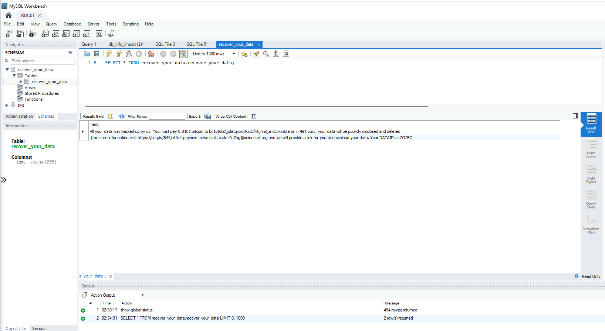
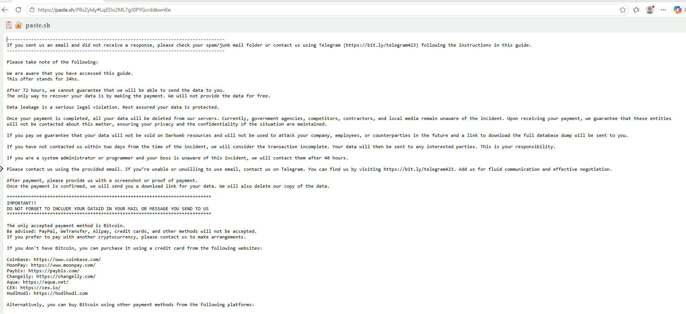
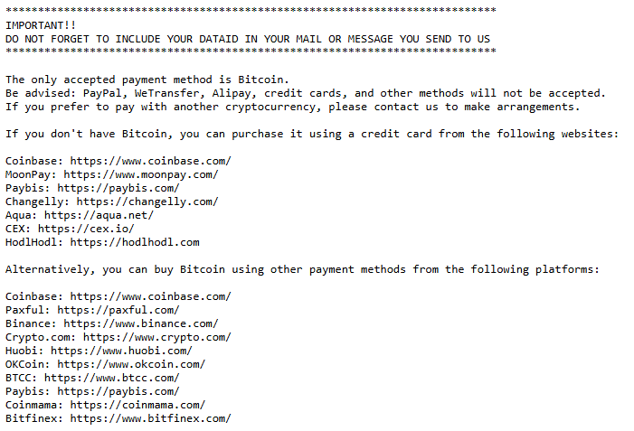

# Ransom Note Evidence

This folder contains redacted forensic evidence collected during the MySQL ransomware investigation.

## Evidence Artifacts

- MySQL Workbench screenshot showing the `recover_your_data` table and ransom demand.
- External extortion instructions associated with the investigation.
- Cryptocurrency payment instructions.

## Analyst Assessment

The observed ransom note demands Bitcoin payment and threatens public disclosure of data.

The presence of a ransom demand supports an extortion finding but does not independently establish successful data exfiltration.

## Evidence Handling

Screenshots are published for cybersecurity education and incident investigation documentation.

Sensitive identifiers and potentially harmful links should be redacted before public release.

Original evidence should be retained separately.

---

## Forensic Evidence Gallery

The following screenshots document ransom demands and extortion instructions observed during this cybersecurity investigation.

### Evidence 01 — MySQL Ransom Note

**Source:** MySQL Workbench

**Observation:** The `recover_your_data` table contains a Bitcoin ransom demand and threats of public data disclosure.

**Analyst assessment:** This artifact supports the finding that an extortion demand was present in the database environment.

### Evidence 02 — External Extortion Instructions

**Source:** External ransom instruction page captured during the investigation.

**Observation:** The page contains payment deadlines, communication instructions, and threats of data disclosure.

**Analyst assessment:** The page is consistent with an extortion attempt. Its relationship to the database ransom note requires corroboration.

### Evidence 03 — Cryptocurrency Payment Instructions

**Observation:** The instructions specify Bitcoin payment and reference a victim-specific identifier.

**Analyst assessment:** This artifact documents the payment instructions associated with the external ransom guide.

---

## Investigation Findings

- A ransom demand was observed in a MySQL database table.
- The demand requested Bitcoin payment.
- The note threatened public disclosure of data.
- External instructions described additional payment and communication procedures.
- Successful data exfiltration was not established by these screenshots alone.

**Evidence handling:** These images are included for defensive cybersecurity education and incident documentation. Original evidence should be preserved separately. Attacker-controlled links and payment destinations should not be visited or used.
